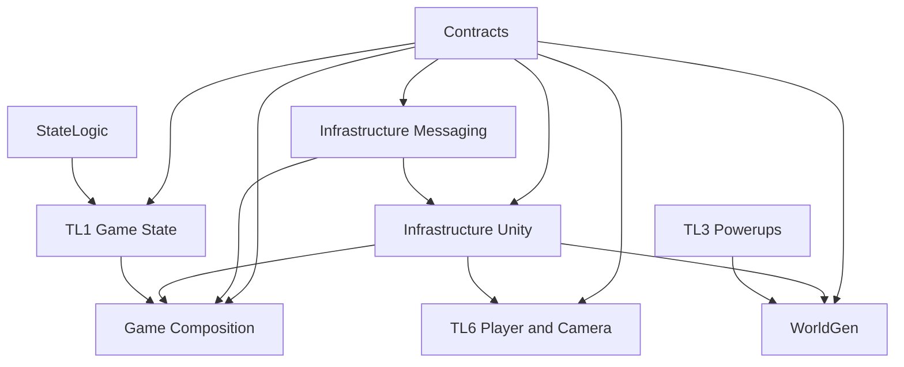
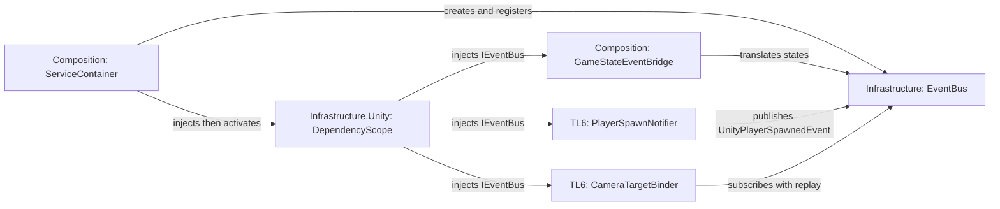

# M9 Dependency Review

**Status:** Archive removal and infrastructure/composition separation are implemented. The state-specific publisher has been replaced with a general typed event bus. Unity compile and Play Mode confirmation remain.
**Updated:** 2026-11-06

## Architecture and dependency trees

Feature assemblies consume shared contracts. Infrastructure implements reusable mechanisms without depending on feature code. Composition is the intentional place for game-specific wiring, where integrations can cross feature boundaries.

## Shared modules

| Assembly | Responsibility | Key contents |
| --- | --- | --- |
| `EscapeThe90s.Contracts` | Engine-neutral feature contracts and messages | `IDependent<T>`, `IEventBus`, lifecycle event structs, `IGameplaySessionState`; deprecated publisher interface retained for existing consumers |
| `EscapeThe90s.Infrastructure` | Reusable typed messaging | `EventBus`, disposable subscriptions, optional latest-event replay |
| `EscapeThe90s.Infrastructure.Unity` | Unity dependency lifecycle support | `DependencyBehaviour`, `DependencyScope`, `UnityPlayerSpawnedEvent` |
| `EscapeThe90s.Dependencies.Unity` | Deprecated compatibility assembly | Legacy namespace/types forwarding to Infrastructure.Unity |
| `EscapeThe90s.Composition` | Game-specific construction and integration | `ServiceContainer`, `GameStateEventBridge` |

`IEventBus` carries any event type, so its name and responsibility cover player notifications and lifecycle events. Contracts contain no `UnityEngine` types; the player `Transform` is carried by the Unity-only `UnityPlayerSpawnedEvent`. The old publisher interfaces and `EscapeThe90s.Dependencies.Unity` assembly/namespace remain as deprecated compatibility surfaces, adapted by `GameStateEventBridge`; new consumers should use the bus and Infrastructure namespaces.

## Concrete uses and ownership

- `GameStateEventBridge` listens to TL1 `GameStateManager` and publishes `GameStartedEvent`, `MenuEnteredEvent`, `GamePausedEvent`, and `GameOverEvent`. The bridge is an adapter; it is not the bus.
- `PlayerSpawnNotifier` publishes `UnityPlayerSpawnedEvent` once its `IEventBus` dependency has been injected.
- `CameraTargetBinder` subscribes to the spawn message with latest replay, so a camera enabled after player creation still attaches to that player. It disposes its subscription on disable.
- `DependencyScope` injects all declared dependencies before activating gated components. It also injects runtime-created objects.
- `GeneratedWorldComposition` uses the scope directly for generated players and reads `IGameplaySessionState`; WorldGen no longer depends on the TL1 assembly or game Composition. Composition implements that query through an adapter, leaving TL1's existing `GameStateManager` unchanged.
- Game Composition creates the event bus and adapts team-owned APIs. World generation supplies spawn information; the existing enemy system owns enemy creation and unloading. A spawn queue can be added when asynchronous producers or multiple consumers require one.

This supports the proposed rule: feature-to-feature contracts are preferred, while Composition is the explicit seam for necessary integrations and responsibility handoffs.

## Assembly reference summary

| Assembly | Direct project references (summary) |
| --- | --- |
| `EscapeThe90s.Contracts` | None |
| `EscapeThe90s.Infrastructure` | Contracts |
| `EscapeThe90s.Infrastructure.Unity` | Contracts, Infrastructure |
| `EscapeThe90s.Dependencies.Unity` (deprecated compatibility) | Contracts, Infrastructure.Unity |
| `EscapeThe90s.Composition` | Contracts, Infrastructure, Infrastructure.Unity, Chris.Game |
| `TL6Assembly` | Contracts, Infrastructure, Infrastructure.Unity, StateLogic, Input System, Cinemachine |
| `EscapeThe90s.WorldGen.Integration` | Contracts, WorldGen.Core, WorldGen.Unity, Infrastructure.Unity, Joe.Game, TL6Assembly |

The archive-only TL2 hash/tile/world-data tests and obsolete TL2/TL4 integration test were removed with the archived system. The active build target remains the playable generated-world game; assembly names retaining “Demo” are historical.

## Archive cleanup and remaining checks

- `Assets/_Archive` and its archive-only test assemblies have been removed, along with six unreferenced assets from the retired grass/dirt tile generator.
- Serialized components that referenced deleted archive scripts were removed from affected scenes and prefabs. A previous static GUID scan found no remaining references to those deleted scripts.
- The former `GameStateEventPublisher` prefab is now `GameStateEventBridge`; its asset GUID is preserved so existing prefab references continue to resolve.
- Static checks still needed after these latest edits: parse all asmdefs, verify the assembly graph is acyclic, scan for old publisher names and stale assembly identifiers, and check whitespace. Unity compilation and Play Mode confirmation remain a manual editor step.
- Confirm the unused `HUDController` field/reference and `UnityEditor.Overlays` import in TL5 before producing a player build.
