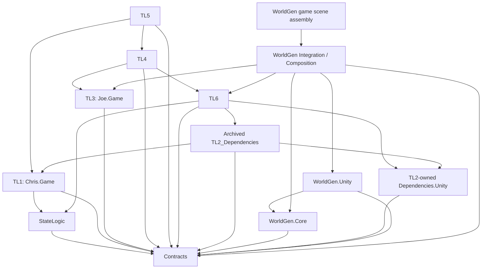
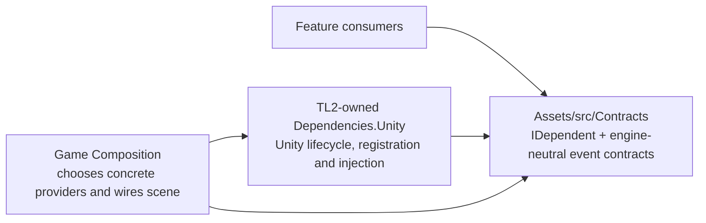

# M9 Dependency Review

**Status:** Review draft; Contracts and a TL2-owned Unity dependency module now have an initial implementation, used by the camera/player-spawn path. A static audit found 34 acyclic asmdefs across Assets (31 project source, test, and archived assemblies plus 3 package/welcome assemblies). Final team review and a fresh Unity compile/Play Mode check remain.  
**Updated:** 2026-11-06

## Scope and counting

This review inventories runtime asmdefs under `Assets/src`, test asmdefs under `Assets/tst`, archived asmdefs, and all other asmdefs under `Assets`. A static graph check resolved assembly-name and GUID references and found 34 total asmdefs, including 31 project source, test, and archived assemblies and 3 package/welcome assemblies. “Direct refs” counts entries in an asmdef, including Unity packages. The file/type table counts direct source-level cross-assembly type use; it does not count comments, serialized scene references, or reflection-only names.

## Runtime and editor assemblies

| Assembly | Direct refs | References |
| --- | ---: | --- |
| `EscapeThe90s.Contracts` | 0 | — |
| `EscapeThe90s.Dependencies.Unity` (TL2-owned module) | 1 | Contracts |
| `StateLogic` | 1 | Contracts |
| `Chris.Game` (TL1) | 5 | Contracts, StateLogic, Unity UI, TextMeshPro, Input System |
| `Joe.Game` (TL3) | 1 | Contracts |
| `TL4Assembly` | 5 | Contracts, TL6Assembly, Joe.Game, Input System, Unity UI |
| `TL5Assembly` | 3 | Contracts, Chris.Game, TL4Assembly |
| `TL6Assembly` | 6 | Contracts, Dependencies.Unity, StateLogic, archived `TL2_Dependencies`, Input System, Cinemachine |
| `EscapeThe90s.WorldGen.Core` | 1 | Contracts |
| `EscapeThe90s.WorldGen.Unity` | 2 | Contracts, WorldGen.Core |
| `EscapeThe90s.WorldGen.Integration` (TL2 Composition adapters) | 5 | Contracts, WorldGen.Core, WorldGen.Unity, Joe.Game, TL6Assembly |
| `EscapeThe90s.WorldGen.Demo` | 5 | Contracts, WorldGen.Core, WorldGen.Unity, WorldGen.Integration, Input System |
| `EscapeThe90s.WorldGen.Editor` | 3 | Contracts, WorldGen.Core, WorldGen.Unity |
| `EscapeThe90s.WorldGen.Demo.Editor` | 4 | Contracts, WorldGen.Core, WorldGen.Unity, WorldGen.Demo |
| `EscapeThe90s.WorldGen.Tests` | 4 | Contracts, WorldGen.Core, Unity test runners |

The TL6 asmdef had a direct reference to archived `TL2_Input`, but no TL6 source file used its types. That unused edge was removed. The archived aggregate assembly still references `TL2_Input` for its legacy code.

Archived asmdef inventory: `Tl2_Caleb` has 8 refs (StateLogic, Input System, Chris.Game, Joe.Game, TL2_Dependencies, TL2_Events, TL2_Input, Cinemachine); `TL2_Dependencies` has 3 (Chris.Game, Contracts, Dependencies.Unity); `TL2_Events` has 2 (Chris.Game, TL2_Dependencies); `TL2_Input` has 3 valid refs (TL2_Dependencies, TL2_Events, Input System) plus one blank entry; `TL2_LevelGen` has 4 (TL2_WorldData, TL2_Hashing, TL2_RNG, TL2_Tiles); `TL2_WorldData` has 2 (TL2_Hashing, TL2_RNG); `TL2_Tiles` has 1 (TL2_WorldData); `TL2_Hashing` and `TL2_RNG` have no asmdef refs.

## Cross-feature source dependencies

| Consumer → dependency | Files | Distinct types | Files and types |
| --- | ---: | ---: | --- |
| TL1 → StateLogic | 2 | 2 | `GameState.cs` (`IState`); `GameStateManager.cs` (`StateMachine<GameState>`) |
| TL4 → TL3 (`Joe.Game`) | 1 | 2 | `EnemyBase.cs` (`PowerUpType`, `PowerUpManager`) |
| TL4 → TL6 | 2 | 1 | `EnemyAttackAnimations.cs`, `EnemyProjectile.cs` (`PlayerHealth`) |
| TL5 → TL1 (`Chris.Game`) | 1 | 1 | `MetaProgressionManager.cs` (`HUDController`, currently only a field declaration; appears unused) |
| TL5 → TL4 | 1 | 1 | `EnemyCoinRewardListener.cs` (`EnemySpawner`) |
| TL6 → StateLogic | 4 | 2 | `MovementState`, `RunningState`, `JumpingState`, `PlayerStateManager` (`BaseState`, `StateManager`) |
| TL6 → `EscapeThe90s.Dependencies.Unity` | 2 | 1 | `CameraTargetBinder.cs`, `PlayerSpawnNotifier.cs` (`DependencyBehaviour`) |
| TL6 → Contracts | 2 | 1 | `CameraTargetBinder.cs`, `PlayerSpawnNotifier.cs` (`IDependent<>`) |
| TL6 → archived `TL2_Dependencies` | 2 | 1 | `CameraTargetBinder.cs`, `PlayerSpawnNotifier.cs` (`IGameStateEventPublisher`, retained for its Unity `Transform` player-spawn event) |
| Archived `TL2_Dependencies` → Dependencies.Unity | 1 | 2 | `ServiceContainer.cs` (`DependencyScope`, `DependencyBehaviour`) |
| Archived `TL2_Dependencies` → Contracts | 2 | 2 | `IDependent.cs`, `IGameStateEventPublisher.cs` (`IDependent<>`, lifecycle `IGameStateEventPublisher`) |
| Dependencies.Unity → Contracts | 2 | 1 | `DependencyBehaviour.cs`, `DependencyScope.cs` (`IDependent<>`) |
| TL2 Integration → TL3 (`Joe.Game`) | 1 | 1 | `GeneratedPlayerPowerUpTarget.cs` (`IPowerUpTarget`) |
| TL2 Integration → TL6 | 1 | 2 | `GeneratedPlayerPowerUpTarget.cs` (`TempPlayerController`, `PlayerHealth`) |
| TL2 Demo → TL2 Integration | 2 | 2 | `WorldNetworkDemo.cs`, `DemoPlayerRig.cs` (`GeneratedStreetContent`, `GeneratedWorldComposition`) |

The Integration assembly is the current Composition boundary: it contains the cross-team adapters and all reflection used by the generated-world demo. Reflection-only names include TL1 game-state types, TL3 power-up types, TL4 `EnemySpawner`, and the team service container; those do not create asmdef references from the Demo assembly.

Reflection-name counts by file: `GeneratedWorldComposition.cs` probes 4 names (`GameStateManager`, `PlayingState`, `TempPlayerController`, `ServiceContainer`); `GeneratedStreetContent.cs` probes 3 (`EnemySpawner`, `PowerUpManager`, `PowerUpItem`). All are contained in the Integration/Composition boundary.

## Test assembly references

| Test assembly | Direct refs | All references |
| --- | ---: | --- |
| `Test_StateMachine` | 4 | Contracts, UnityEngine.TestRunner, UnityEditor.TestRunner, StateLogic |
| `Tests_TL1` | 6 | Contracts, both Unity test runners, Chris.Game, Unity.TextMeshPro, StateLogic |
| `TL2_Tests` | 7 | Contracts, both Unity test runners, archived TL2_Hashing, TL2_RNG, TL2_WorldData, TL2_Tiles |
| `Tests_TL3` | 5 | Contracts, both Unity test runners, Joe.Game, Unity.TextMeshPro |
| `TL4Tyler_Tests` | 11 | Contracts, both Unity test runners, TL4Assembly, Joe.Game, TL6Assembly, Unity.TextMeshPro, archived Tl2_Caleb, Chris.Game, TL2_Events, TL2_Dependencies |
| `Will_Tests` | 5 | Contracts, both Unity test runners, TL5Assembly, Unity.TextMeshPro |
| `Matteo_Tests` | 6 | Contracts, both Unity test runners, TL6Assembly, StateLogic, Unity.TextMeshPro |

Test assemblies also reference Contracts and Unity's test runner assemblies. Their broader links are test-only and are not runtime dependency edges.

## Graph findings and team actions

- **No assembly cycle was found in the current 34-asmdef Assets graph.** This includes 31 project source/test/archive assemblies and 3 package/welcome assemblies. The TL2-owned Dependencies.Unity assembly points only to Contracts; the updated TL2_Dependencies and TL6 references point toward it, preserving the acyclic direction.
- **The current graph does not yet meet the strict Contracts-only feature rule.** Runtime feature edges remain TL4 → TL3/TL6, TL5 → TL1/TL4, and TL6 → StateLogic/legacy `TL2_Dependencies`. The TL2 Integration/Composition edges to TL3 and TL6 are expected for adapters, but the team should decide whether these belong in one shared Composition assembly.
- **Archived code is still part of Unity's assembly graph.** `Assets/_Archive/TL2_Caleb_Legacy` still contains referenced asmdefs. The archived `TL2_Input.asmdef` also has an empty reference entry; preserve it for now, and clean it up only when the legacy fallback no longer requires that assembly.
- **Possible stale TL5 references:** `HUDController` appears only as an unused field in `MetaProgressionManager.cs`; that assembly reference should be confirmed with TL5 before removal. The same file imports `UnityEditor.Overlays`, with no use found in that file; confirm whether it is leftover editor-only code before a player build.
- **Recommended next review with the team:** agree which cross-feature APIs move to Contracts, which adapters move into the shared Composition assembly, and who owns the TL6 legacy dependency contracts. Then update the asmdefs and re-run this graph check.

## Dependency trees and proposed Contracts example

The current runtime dependency tree is acyclic. The following view focuses on the high-level feature relationships; Unity package references and tests are listed in the tables above.

For the dependency-injection/event pattern, the intended dependency direction is:

`DependencyBehaviour` belongs in the TL2-owned Unity module; `IDependent<T>` and the engine-neutral `IGameStateEventPublisher` lifecycle contract belong in Contracts. `DependencyScope` provides explicit service registration, two-phase scene injection, activation gating, and a dynamic-object injection path. Composition selects concrete implementations and lifetime. The old global `IDependent<T>` remains as an archived compatibility shim inheriting the Contracts interface; the existing game `ServiceContainer` now delegates injection to `DependencyScope`.

The archived `TL2_Dependencies.IGameStateEventPublisher` now extends the Contracts lifecycle contract. It retains the `Transform` player-spawn event as a Unity-specific extension so Cinemachine can follow a concrete target while Contracts remains engine-independent (`noEngineReferences: true`). The legacy publisher remains the current game's implementation during this migration.

### Real use cases in the current game path

- `PlayerSpawnNotifier` receives the publisher through `IDependent<IGameStateEventPublisher>` and reports the player transform only after the injection/activation phases finish. This avoids publishing a spawn before the publisher has subscribed to game state.
- `CameraTargetBinder` receives the same publisher contract, subscribes only after its required service is injected, follows the current player, and cleans up its event subscription when disabled.
- `GeneratedWorldComposition` injects dynamically created player objects through the existing composition entry point. `ServiceContainer` delegates that work to `DependencyScope`, so the same injection gate applies to runtime-created players.

These are narrow concrete injection use cases. `DependencyScope` intentionally leaves provider creation, scene lifetime, and policy in Composition; it is an optional utility rather than a global service locator.

## Integration ownership for shipping the game

Integration code can blur ownership, so use these boundaries for the first complete-game release:

- `GameStateManager` owns run state and transitions (menu, playing, pause, game over). It should gate run start/stop and coordinate lifecycle; it should not own enemy creation or terrain-specific spawn rules.
- World generation owns deterministic spawn descriptions (what kind, where, and which chunk owns the spawn). It should not instantiate TL4 enemy prefabs.
- The enemy system owns prefab selection, pooling/instantiation, activation, and unloading. It consumes spawn descriptions and chunk lifecycle signals.
- The Composition assembly connects these systems. For the current single-player release, a direct adapter from generated spawn descriptions to the existing `EnemySpawner` is the smallest shippable option. Move to a queue when asynchronous production, multiple producers/consumers, retries, or back-pressure are actually needed; adding a queue now would add lifecycle and debugging work without a current gameplay need.

This keeps the release path focused on completing and stabilizing the playable game. “Demo” in older assembly and file names is historical; the target is the game scene and its end-to-end run loop, not a separate showcase deliverable.

## Work before final team submission

- Replace the legacy publisher's Unity-specific extension with a current-game adapter in the appropriate Composition assembly, then remove TL6's direct reference to archived `TL2_Dependencies` when the scene and prefabs use that adapter. Preserve the archived implementation for rollback.
- Confirm the Contracts-only rule with the team and identify Composition as the approved exception. The diagrams here are a proposal and example, not a claim that every team has agreed to this policy.
- Re-audit assembly references and source-level file/type counts after the module migration; update the trees to reflect the shipped-game scene wiring.

## Conclusion

The dependency module and Contracts have been introduced and are exercised by two TL6 consumers plus dynamic-player injection. Final M9 submission still needs a fresh Unity compile/Play Mode check, a refreshed complete graph count, and team discussion of the proposed policy and Composition responsibilities.
